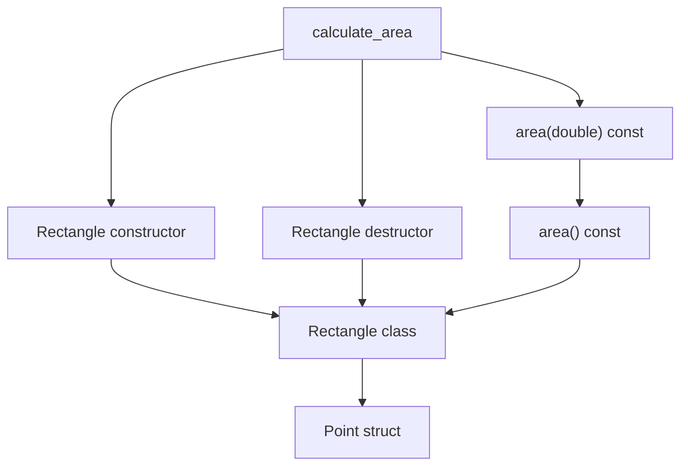

# Wavefront on a small C++ library

This example follows `calculate_area` through a C++17 library. `Rectangle`
contains two `Point` values. The caller constructs a rectangle, invokes the
scaled `area` overload, and implicitly destroys the rectangle at scope exit.
The scaled overload calls the zero-argument overload.

From the Wavefront checkout, with Python 3.13+, CodeQL, and `g++` on `PATH`:

```sh
codeql pack install src
bash examples/cpp_geometry/run.sh
```

The runner builds a fresh CodeQL database, runs Wavefront's normal CLI, and
checks the output. It prints the path to the run directory. Where CodeQL
cannot trace the compiler (Apple Silicon without Rosetta), set
`WAVEFRONT_BUILD_MODE=none` to extract the sources without a build; the
tables are the same for this example. `PYTHON` selects the interpreter.

| File | Contents |
| --- | --- |
| `types.json` | `geometry::Point` and `geometry::Rectangle` are defined types. The rectangle has `lower_` and `upper_` fields. |
| `symbols.json` | The two `area` overloads have separate records. `declaring_type` and `member_kind` identify the constructor, destructor, and methods. |
| `dependencies.json` | The dependency closure of `calculate_area`, including the implicit destructor call. |
| `schedule.json` | `Point` precedes `Rectangle`. The class precedes its operations, and the caller follows the operations it uses. |

The diagram shows selected dependencies. Arrows point from a consumer to a
prerequisite.



The example covers named classes, member types, overloads, and direct and
scope-exit calls. The constructor and destructor classifications describe the
C++ declarations. Ownership findings remain a separate input to migration.
